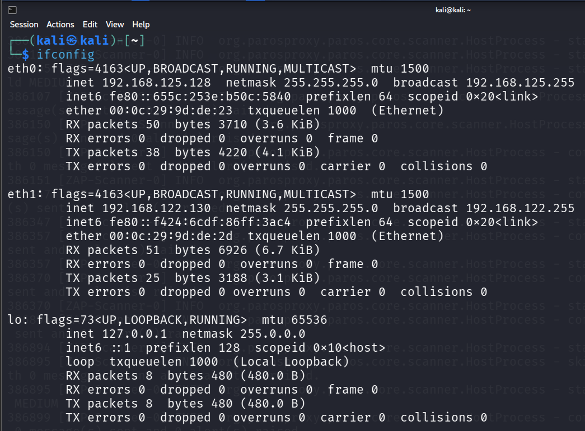
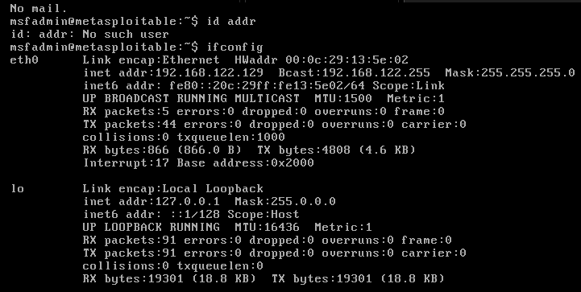
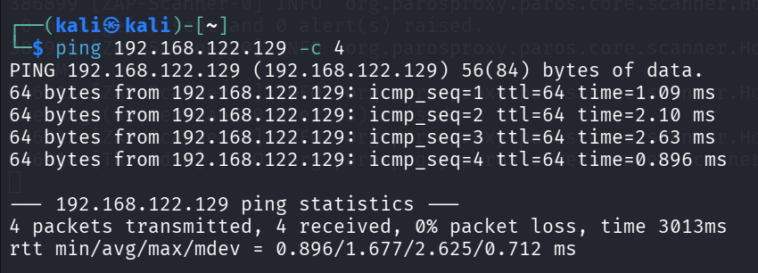
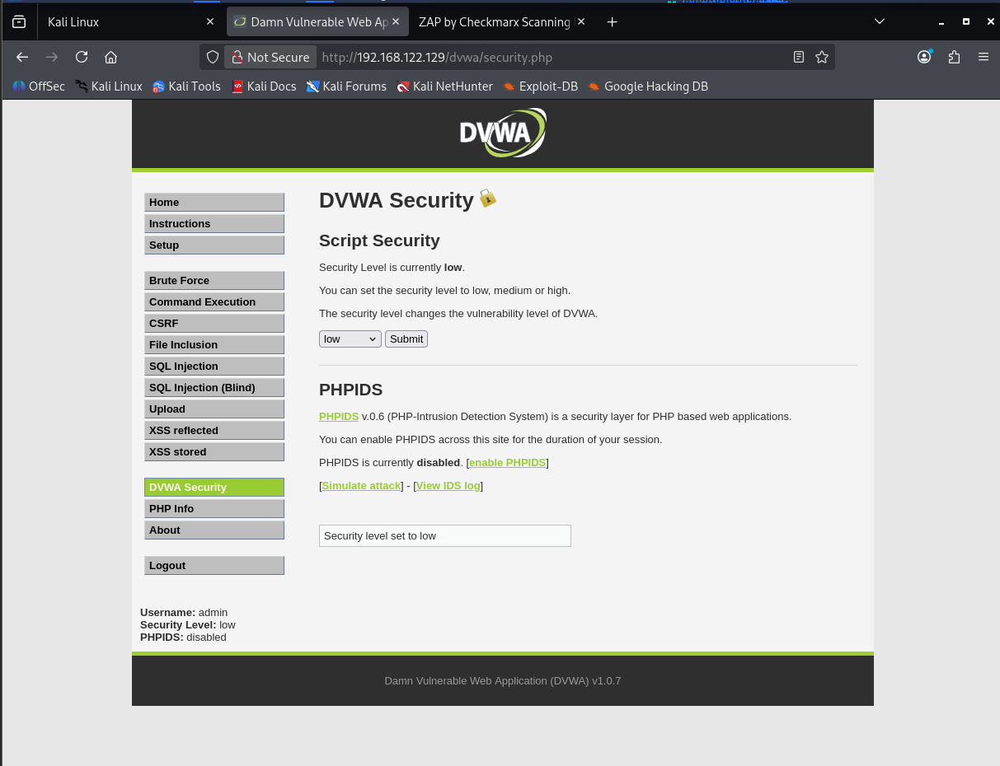
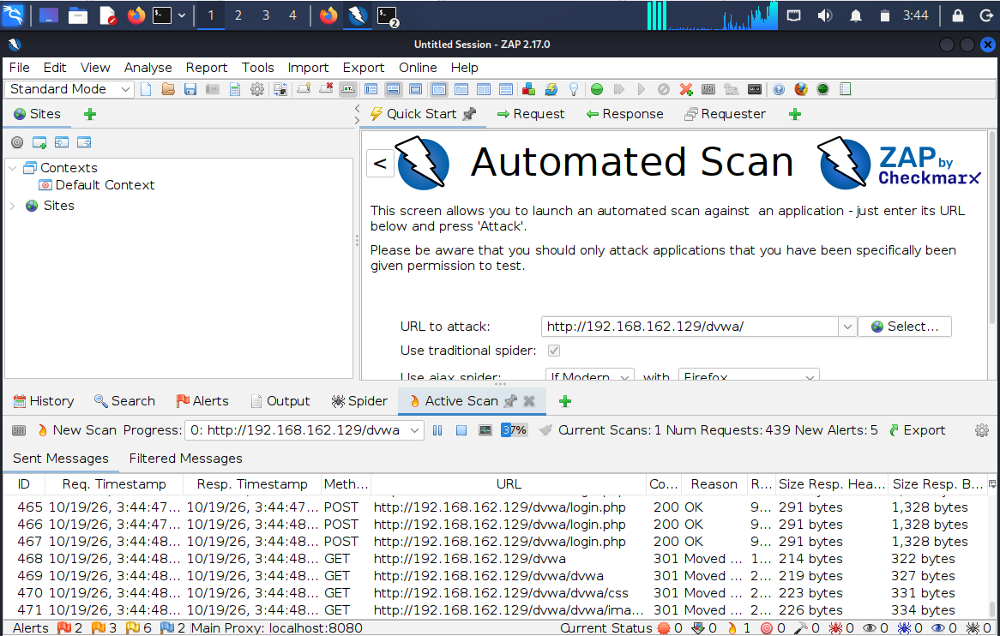
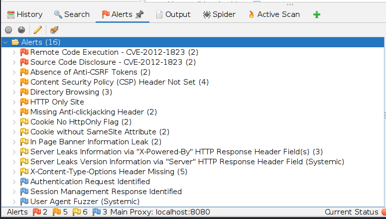
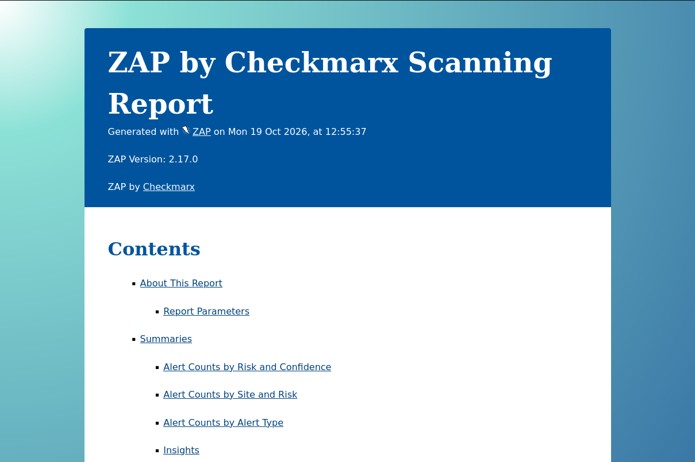

# Experiment 6: Website Risk Assessment using OWASP ZAP

## Objective

To scan a sample web application using OWASP ZAP and identify potential security vulnerabilities based on the OWASP Top 10 checklist.

## Procedure

### Step 1: Configure the Network and Identify IP Addresses

Start Kali Linux and Metasploitable 2 virtual machines on the same network. Use `ip a` on Kali Linux and `ifconfig` on Metasploitable to identify their network interfaces and IP addresses.

# Commands:
```bash
# Kali Linux
ip a

# Metasploitable
ifconfig
```




### Step 2: Test Network Connectivity

From Kali Linux, ping the Metasploitable IP address to verify that the target machine is reachable.

# Command:
```bash
ping 192.168.122.129 -c 4
```



### Step 3: Access DVWA and Configure Its Security Level

Open the web browser in Kali Linux and access the Damn Vulnerable Web Application (DVWA) hosted on Metasploitable. Log in using the lab credentials, navigate to **DVWA Security**, and set the security level to **Low**.

Target URL: `http://192.168.122.129/dvwa/`



### Step 4: Launch the OWASP ZAP Automated Scan

Launch OWASP ZAP and select **Automated Scan** from the Quick Start page. Enter the DVWA URL in the target field and click **Attack** to begin scanning the web application.

Target URL: `http://192.168.122.129/dvwa/`



### Step 5: Identify the Detected Vulnerabilities

After the scan generates findings, open the **Alerts** tab in OWASP ZAP. Examine the detected vulnerabilities and their risk levels to understand the potential security weaknesses in the application.



### Step 6: Examine Vulnerability Details and Generate the Report

Select a detected vulnerability in OWASP ZAP to inspect its description, evidence, and potential impact. Use the reporting feature to generate an HTML report or another available report format documenting the scan results.



## Result

The experiment demonstrated automated website vulnerability assessment using OWASP ZAP. Potential security vulnerabilities in DVWA were identified, examined, and documented in a scanning report.
